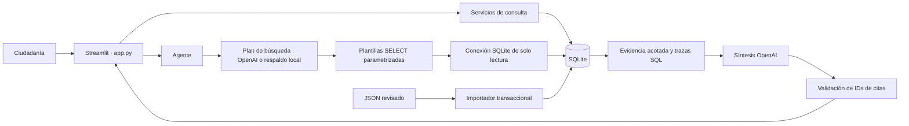

# Memoria Hídrica GDL

**Una memoria verificable de cómo llegamos hasta aquí.**

MVP local en Python y Streamlit para reconstruir la historia de la crisis del agua en Guadalajara. Reúne eventos, fuentes, declaraciones, responsabilidades institucionales y compromisos para evitar que la discusión pública pierda sus antecedentes. No atribuye culpabilidad.

## Ejecutar

Requiere Python 3.10 o posterior.

```bash
python3 -m venv .venv
source .venv/bin/activate
pip install -r requirements.txt
cp .env.example .env
python seed_db.py
streamlit run app.py
```

Abre la dirección local que muestra Streamlit. Edita `.env` para configurar `OPENAI_API_KEY` y, opcionalmente, `OPENAI_MODEL`. Nunca publiques la clave. Sin clave funcionan todas las vistas y la recuperación local de evidencia; la síntesis del agente requiere la API. Las llamadas al modelo envían la pregunta y evidencia seleccionada al proveedor y pueden generar costos. La aplicación no escribe claves en SQLite.

**Los datos iniciales son completamente ficticios.** No hay hechos históricos verificados precargados, URLs inventadas ni citas reales simuladas. Activa «Mostrar datos de demostración» para explorar cinco eventos de ejemplo. El agente excluye siempre esos datos. Con la base inicial responde que no tiene evidencia suficiente: es el comportamiento esperado.

## Funcionalidad

- Línea del tiempo con filtros por año, categoría y actor/institución; contexto, actores y fuentes por evento.
- Chat con preguntas sugeridas, historial de sesión, consultas SQL, parámetros, evidencia recuperada y fuentes citadas.
- Comparación cronológica de declaraciones de uno o varios actores sin calificarlas de mentiras.
- Compromisos agrupados por estado, con detalle del plazo, actor, evento y fuente.
- Catálogo de fuentes y metodología. Los registros sin verificar se excluyen del modo normal.

## Arquitectura



`database/schema.sql` define el esquema; `database/db.py` configura conexiones y claves foráneas; `database/seed.py` importa JSON; `services/records.py` sirve las vistas; `agent/sql_tools.py` recupera evidencia; `agent/prompts.py` define las reglas; `agent/agent.py` planifica y sintetiza.

## Modelo de datos

| Tabla | Contenido |
|---|---|
| actors | Personas, instituciones, tipo, cargo, periodo y notas |
| events | Fecha, título, descripción, categoría, ubicación y relevancia |
| sources | Título, editor, URL original, fecha, tipo y notas de confiabilidad |
| event_sources | Relación muchos a muchos entre eventos y fuentes |
| event_actors | Relación explícita entre eventos y actores, utilizada por filtros |
| claims | Declaración atribuida a un actor, fecha, evento y fuente |
| responsibilities | Deber institucional, periodo, fundamento y fuente |
| commitments | Promesa, actor, evento, plazo, estado y fuente |

Las entidades editoriales tienen `verified` (0/1). En declaraciones, significa que se revisó **la atribución**, no que el contenido se haya demostrado verdadero. Las relaciones utilizan claves foráneas. Fechas: ISO `YYYY-MM-DD`; campos opcionales desconocidos: `null`. Estados permitidos: `announced`, `in_progress`, `completed`, `delayed`, `unfulfilled`, `unknown`. El esquema no reemplaza una revisión editorial de fechas, URLs o taxonomías.

## Cómo trabaja el agente

1. Recibe una pregunta y pide al modelo términos de búsqueda y un año límite opcional. Si la API falla, utiliza términos locales.
2. Construye SELECT parametrizados mediante plantillas controladas; nunca ejecuta SQL escrito por el modelo.
3. Recupera hasta 25 eventos verificados con fuente verificada y URL, actores vinculados, hasta 50 declaraciones/compromisos/responsabilidades y sus fuentes. Incluye las relaciones evento-fuente.
4. Entrega solo esa evidencia al modelo para una respuesta en el idioma de la pregunta, separando hechos, declaraciones, responsabilidades e interpretación.
5. Valida que las citas `[S1]` correspondan a los IDs recuperados y muestra las URLs originales por separado. Las respuestas con citas inválidas se descartan.

El modo SQLite `ro`, `query_only` y un autorizador restringen las consultas del agente a lectura. No hay consola de SQL arbitrario. Los parámetros se muestran aparte del SQL para hacer visible la consulta real.

«¿Quién sabía qué y cuándo?» solicita la cronología más temprana disponible y diferencia advertencias, recepción documentada y compromisos. Un cargo institucional no demuestra conocimiento de un aviso. Una búsqueda acotada no permite afirmar que un aviso sea el primero de toda la historia. Las responsabilidades se recuperan por actor; el modelo debe comprobar sus periodos. La validación de citas comprueba su existencia, no garantiza que toda interpretación del modelo sea correcta: revisa la evidencia.

## Añadir datos históricos reales

1. Copia `data/seed_data.json` a un archivo de trabajo y reemplaza los ejemplos por registros revisados. Conserva los nombres de tabla y columnas. Usa IDs nuevos para evitar colisiones con los ejemplos (por ejemplo, desde 1000).
2. Registra primero actores, eventos y fuentes. Conserva la URL exacta del documento consultado, su editor y fecha; añade notas sobre sus límites. Prioriza fuentes oficiales o primarias.
3. Vincula cada evento con sus fuentes en `event_sources` y sus actores en `event_actors`. Añade declaraciones, responsabilidades y compromisos con su `source_id`.
4. Marca `verified: 1` únicamente después de la revisión editorial. Eventos, declaraciones, compromisos y responsabilidades necesitan además una fuente verificada con URL para aparecer en el modo normal o ser evidencia del agente. No marques un compromiso cumplido sin respaldo documental.
5. Importa:

```bash
python seed_db.py --file data/verified_records.json
```

El importador es transaccional e idempotente: preserva IDs existentes y no sobrescribe registros. Para corregir un registro existente, edita SQLite mediante una herramienta local de confianza, fuera del agente; respalda el archivo antes. No existe interfaz administrativa en este MVP. `DATABASE_PATH` permite usar una base distinta para datos reales. La aplicación sin seed crea un esquema vacío y muestra un estado inicial útil.

## Verificación

```bash
python -m unittest discover -s tests -v
```

Prueba aislamiento de datos ficticios, importación idempotente, transacciones y claves foráneas, filtros, relaciones de evidencia, consultas parametrizadas, bloqueo de escrituras y las cinco vistas con Streamlit AppTest. Las pruebas usan una base temporal; no consultan OpenAI ni modifican el archivo local.

## Siguiente iteración

Incorporar un corpus real revisado, evidencia de cambios de estado de compromisos, edición/importación asistida con validación editorial, mejores búsquedas de sinónimos y pruebas de calidad del agente con preguntas históricas revisadas. El MVP no incluye investigación web automática, autenticación ni despliegue. Una respuesta del modelo no sustituye la revisión de documentos originales.
